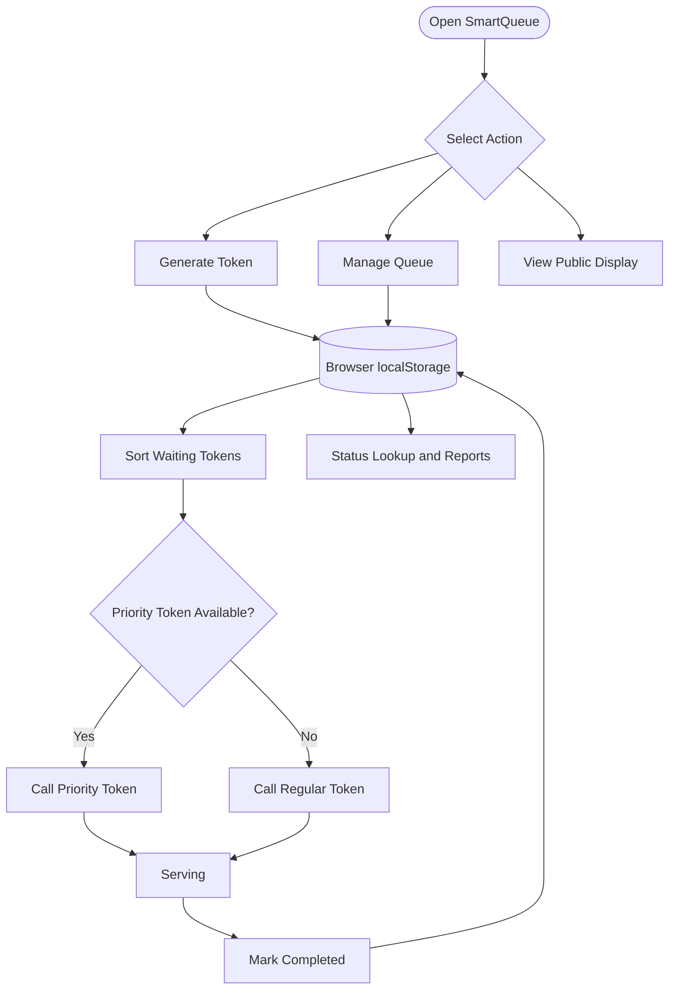
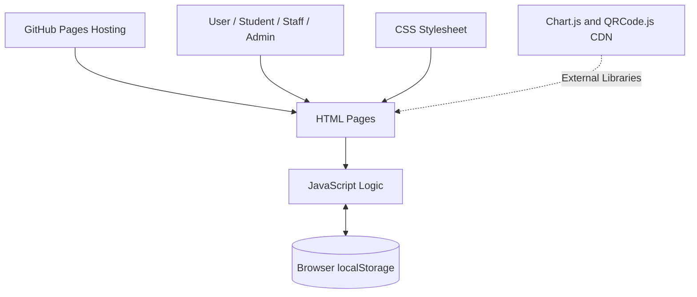

 <div align="center">

# 🟣 SmartQueue
### Smart Queue & Token Management System

**Less waiting. Clearer queues. Better service experiences.**

[](https://rajharshit25.github.io/smart-queue-system/)
[](https://github.com/rajharshit25/smart-queue-system)


*A browser-based academic mini-project for digital token generation, queue management, priority handling, and live queue display.*

</div>

---

## 📌 Table of Contents

- [🌟 About the Project](#-about-the-project)
- [✨ Features](#-features)
- [🖥️ Live Website](#️-live-website)
- [🔐 Demo Login Credentials](#-demo-login-credentials)
- [🔄 Workflow](#-workflow)
- [🏗️ System Architecture](#️-system-architecture)
- [📂 Project Structure](#-project-structure)
- [🛠️ Technologies Used](#️-technologies-used)
- [⚙️ Run Locally](#️-run-locally)
- [🚀 Deployment](#-deployment)
- [🗃️ Data Model](#️-data-model)
- [🔒 Limitations and Security](#-limitations-and-security)
- [🛣️ Future Enhancements](#️-future-enhancements)
- [🤝 Contributing](#-contributing)
- [👨‍💻 Project Information](#-project-information)

## 🌟 About the Project

**SmartQueue** is a Smart Queue and Token Management System developed as a college AWP mini-project.

Traditional queues can cause long waiting times, crowding, confusion, and difficulty tracking service progress. SmartQueue demonstrates how a digital token system can help organise service requests and make queue information easier to access.

The project supports three example services:

- 🏫 **College Office**
- 🏥 **Clinic**
- 🍽️ **College Canteen**

Users can generate tokens, staff can manage the queue, and visitors can check token status through a browser-based interface.

> **🎯 Project goal:** Demonstrate a simple, organised, user-friendly digital queue management experience.

## ✨ Features

| Feature | Description |
|---|---|
| 🎟️ Token Generation | Generate service tokens with a token number and receipt. |
| 🏷️ Service Selection | Choose College Office, Clinic, or College Canteen. |
| ⚡ Priority Queue | Mark waiting tokens as priority and serve them before regular waiting tokens. |
| 🧑‍💼 Staff Dashboard | Call the next token, complete requests, change priority, and manage tokens. |
| 📺 Public Queue Display | View the currently serving token and waiting queue. |
| 🔎 Token Status Lookup | Check token status, service, people ahead, and estimated waiting time. |
| 📊 Admin Dashboard | View queue summaries and recent token information. |
| 📈 Reports and Charts | Visualise report data using Chart.js. |
| 📄 CSV Export | Export report data for review. |
| 🖨️ Print Support | Print token receipts and reports where supported. |
| 🔐 Role-Based Demo Access | Demonstrate Admin, Staff, and Student interfaces. |
| 💜 Modern UI | Purple-themed interface with structured navigation. |
| 🌐 Web Deployment | Host the static website using GitHub Pages. |

## 🖥️ Live Website

### 🚀 Try SmartQueue online

**Live demo:**  
https://rajharshit25.github.io/smart-queue-system/

**GitHub repository:**  
https://github.com/rajharshit25/smart-queue-system

The deployed version is a front-end demonstration. It uses browser storage rather than a shared backend database.

## 🔐 Demo Login Credentials

Use these sample accounts to explore the role-based interface.

| Role | Username | Password | Landing Page |
|---|---|---|---|
| 🛡️ Admin | `admin` | `Admin123` | `dashboard.html` |
| 🧑‍💼 Staff | `staff` | `Staff123` | `staff.html` |
| 🎓 Student | `student` | `Student123` | `token.html` |

> ⚠️ **Security warning:** These credentials are for demonstration only. The login logic runs in front-end JavaScript and can be inspected or bypassed. Never use real passwords or sensitive personal information.

## 🔄 Workflow

The basic queue lifecycle is:

1. 🎟️ **Generate Token** — A student selects a service and generates a token.
2. ⏳ **Wait in Queue** — The new token receives `Waiting` status.
3. ⚡ **Prioritise When Needed** — A waiting token may be marked as priority.
4. 📢 **Call Next Token** — Staff calls the next eligible waiting token.
5. 🧑‍💼 **Serve Request** — The token changes to `Serving`.
6. ✅ **Complete Request** — Staff marks the token `Completed`.
7. 📊 **Review Status** — The display, lookup, and report pages show the available queue information.

### Workflow Diagram



## 🏗️ System Architecture

SmartQueue uses a simple client-side architecture.



### Architecture Components

- **Presentation Layer:** HTML pages provide the interface.
- **Styling Layer:** CSS controls layout, colours, and visual presentation.
- **Application Logic:** JavaScript handles tokens, queue actions, status lookup, and demo role checks.
- **Storage Layer:** `localStorage` stores queue records and the current demo user in the browser.
- **Reporting Layer:** Chart.js supports report visualisations.
- **Receipt Layer:** QRCode.js can generate QR codes for token receipts when the library loads.
- **Hosting Layer:** GitHub Pages serves the static website using HTTPS.

> GitHub Pages does not run a Node.js server or provide a database. The current architecture is suitable for demonstrating front-end functionality, not for operating a shared production queue.

## 📂 Project Structure

```text
smart-queue-system/
│
├── index.html              # Home page
├── login.html              # Login page
├── dashboard.html          # Admin dashboard
├── token.html              # Token generation and receipt
├── staff.html              # Staff queue management
├── display.html            # Public queue display
├── status.html             # Token status lookup
├── reports.html            # Charts, filters, CSV export, and print
│
├── public/
│   ├── css/
│   │   └── style.css       # Shared styles and purple theme
│   │
│   └── js/
│       ├── auth.js         # Demo authentication and role navigation
│       ├── dashboard.js    # Dashboard-related script
│       ├── display.js      # Display-related script
│       ├── staff.js        # Staff-related script
│       └── token.js        # Token-related script
│
├── models/
│   └── Token.js            # Optional server-side model file
│
├── server.js               # Optional Node.js server entry point
├── package.json            # Project scripts and metadata
├── package-lock.json       # npm dependency lock file
└── README.md               # Project documentation
```

*Note: Some pages may contain inline JavaScript. The exact division of logic between inline scripts and separate files depends on the current implementation. The server-side files are not executed by GitHub Pages.*

## 🛠️ Technologies Used

| Technology | Purpose |
|---|---|
| 🧱 HTML5 | Structure and content of web pages |
| 🎨 CSS3 | Layout, styling, and responsive presentation |
| ⚙️ JavaScript | Queue logic and user interactions |
| 💾 localStorage | Browser-local queue and demo session storage |
| 📊 Chart.js | Report charts |
| 🔳 QRCode.js | QR code generation for token receipts |
| 🌿 Git | Version control |
| 🐙 GitHub | Source code repository |
| 🌐 GitHub Pages | Static website hosting |
| 💻 VS Code | Development environment |

## ⚙️ Run Locally

### Requirements

- A modern web browser
- Visual Studio Code (recommended)
- Node.js and npm if using the npm server script

### Option 1: VS Code Live Server

1. Download or clone the repository.
2. Open the project folder in VS Code.
3. Install the **Live Server** extension if required.
4. Right-click `index.html`.
5. Select **Open with Live Server**.

### Option 2: Run with npm

Open the terminal in the project folder and run:

```powershell
npm install
npm start
```

If PowerShell blocks the `npm` command, try:

```powershell
npm.cmd install
npm.cmd start
```

Open the local URL printed by the server in your browser. Keep the terminal running while testing.

## 🚀 Deployment

SmartQueue is published using **GitHub Pages** from the `main` branch and repository root.

### Deployment Settings

- **Repository:** `rajharshit25/smart-queue-system`
- **Branch:** `main`
- **Folder:** `/` (repository root)
- **Hosting:** GitHub Pages
- **HTTPS:** Enabled

### Update the website

After editing your project, run:

```powershell
git add .
git commit -m "Update SmartQueue"
git push origin main
```

Once GitHub Pages finishes deploying the new commit, refresh the live website.

**Live URL:** https://rajharshit25.github.io/smart-queue-system/

## 🗃️ Data Model

A token record follows this general structure:

```json
{
  "id": "unique-token-id",
  "name": "Example Visitor",
  "service": "College Office",
  "tokenNumber": "CO001",
  "status": "Waiting",
  "createdAt": "2026-10-20T10:00:00.000Z",
  "priority": false
}
```

### Field descriptions

| Field | Description |
|---|---|
| `id` | Unique token identifier |
| `name` | Name entered for the demo |
| `service` | Selected service |
| `tokenNumber` | Token number, such as `CO001`, `CL001`, or `CA001` |
| `status` | `Waiting`, `Serving`, or `Completed` |
| `createdAt` | Creation time in ISO format |
| `priority` | Indicates whether a token is marked as priority |

### Browser Storage Keys

- `smartQueueTokens` — stores queue token records.
- `smartQueueUser` — stores the current demo user/session information.

**Important:** `localStorage` is specific to a browser profile and website origin. A token generated in one browser or device is not automatically shared with other users. Clearing browser site data may remove saved demo records.

## 🔒 Limitations and Security

This project is an academic front-end demo. Its main limitations are:

- **No shared database:** Queue records are stored locally in each browser.
- **Demo-only login:** Client-side authentication can be inspected and bypassed.
- **No backend on GitHub Pages:** `server.js` and server-side models are not executed by static hosting.
- **External dependencies:** Charts and QR codes may depend on CDN availability.
- **Estimated waiting times:** These are illustrative estimates, not guaranteed service times.

### Production Improvements

A production-ready system could add:

- A backend API and a shared database.
- Server-side authentication and role authorisation.
- Secure password hashing and session management.
- Real-time synchronisation across devices.
- Input validation, audit logs, and rate limiting.
- Automated tests and deployment checks.
- Privacy controls and data retention policies.

## 🛣️ Future Enhancements

- [x] Token generation and receipt
- [x] Service selection
- [x] Priority queue demonstration
- [x] Staff queue controls
- [x] Public queue display
- [x] Token status lookup
- [x] Dashboard and report pages
- [x] CSV export and print support
- [x] GitHub Pages deployment
- [ ] Shared database-backed queue
- [ ] Secure server-side authentication
- [ ] Real-time cross-device updates
- [ ] Automated testing
- [ ] More detailed analytics and configurable wait estimates

## 🤝 Contributing

Contributions and suggestions are welcome.

1. Fork the repository.
2. Create a branch:

   ```bash
   git checkout -b feature/your-improvement
   ```

3. Make and test your changes.
4. Commit your work:

   ```bash
   git commit -m "Add your improvement"
   ```

5. Push your branch and open a pull request.

Please do not commit credentials, private data, `.env` files, or unnecessary `node_modules` content.

## 👨‍💻 Project Information

| Detail | Information |
|---|---|
| Project Name | SmartQueue |
| Full Name | Smart Queue & Token Management System |
| Project Type | College AWP Mini-Project |
| Front End | HTML, CSS, JavaScript |
| Storage | Browser `localStorage` |
| Repository | [GitHub Repository](https://github.com/rajharshit25/smart-queue-system) |
| Live Website | [Open SmartQueue](https://rajharshit25.github.io/smart-queue-system/) |

---

<div align="center">

## 🟣 SmartQueue

**Organising queues, one token at a time.**

*Built as an academic demonstration using HTML, CSS, and JavaScript.*

[🌐 Live Website](https://rajharshit25.github.io/smart-queue-system/) · [🐙 GitHub Repository](https://github.com/rajharshit25/smart-queue-system)

</div>